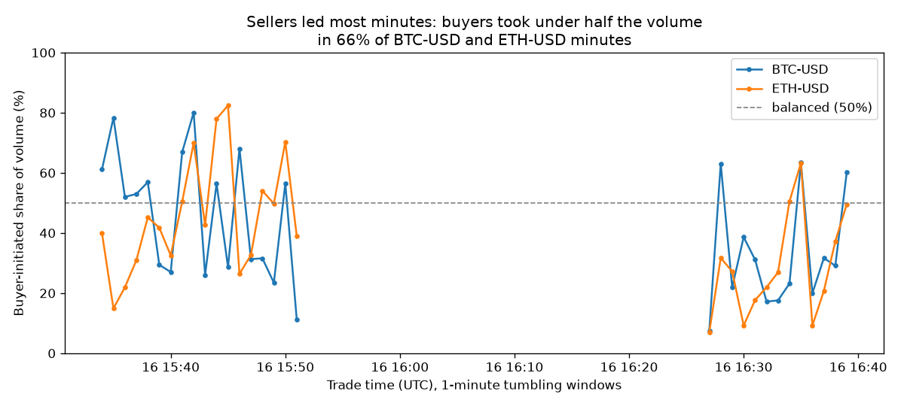
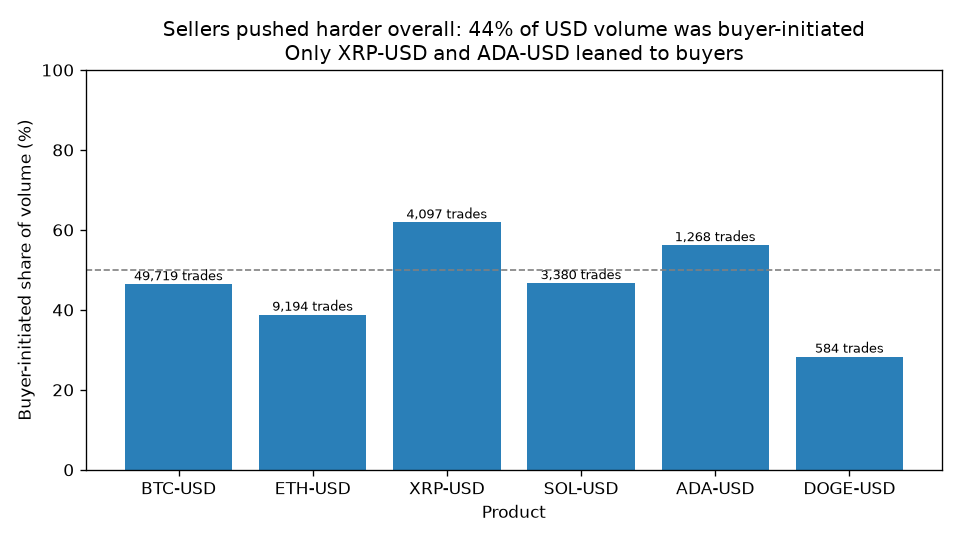

# Buying vs. selling pressure on Coinbase: a Kafka stream-ingestion pipeline

**Author:** Khalid Bakhit
**DS 3022 Data Project 3, Fall 2026**

## Data source

My data is live trades from the **Coinbase Exchange WebSocket feed** (`wss://ws-feed.exchange.coinbase.com`), on the `matches` channel, for six products: BTC-USD, ETH-USD, SOL-USD, XRP-USD, DOGE-USD and ADA-USD. It is a **push** source, one connection stays open and Coinbase sends one JSON message for every trade. You don't need an account, key or User-Agent, but the subscribe message has to be sent within 5 seconds of connecting. Since this feed has **no replay or history**, every record was collected live (Mon 16 Nov 2026, 16:34–16:51 and 17:27–17:40 local time).

One trade message has `type` ("match"), `trade_id`, `product_id`, `side` (the **maker's** side), `price`, `size`, `sequence`, `time` (when the trade happened) and the maker and taker order ids. On top of that, each connection also sends one `subscriptions` message and one `last_match` per product (the last trade before I connected), and these are not new trades.

When I probed it on Wed 11 Nov in the evening, the rate was 11.77 messages/s. However, the real collection on Monday afternoon ran at about **47.7 messages/s** (47,979 messages in 16 min 45 s), which is four times faster.

## How to run

These steps start from a fresh clone, on macOS/Linux (Windows lines are in the comments), with Docker Desktop running. Keep the project **outside iCloud-synced folders** like Documents (see Challenges).

```bash
git clone https://github.com/Khalid-Bakhit/ds3022-streaming.git
cd ds3022-streaming
python3 -m venv .venv
source .venv/bin/activate                      # Windows (PowerShell): .venv\Scripts\Activate.ps1
pip install -r requirements.txt prefect matplotlib "fastapi<=0.150"   # newer FastAPI breaks the Prefect server

docker compose up -d                                              # 3-broker Redpanda cluster + Console
docker exec -it redpanda-0 rpk cluster info                       # 3 brokers
docker exec -it redpanda-0 rpk topic create coinbase_trades -p 3 -r 3
```

After that, open four terminals and run `source .venv/bin/activate` in each one (Windows: `.venv\Scripts\Activate.ps1`):

```bash
# T1 (in project3): producer, Ctrl+C to stop
cd project3 && python producer.py

# T2 (in project3): lander, writes data/raw/*.parquet, Ctrl+C to stop
cd project3 && python lander.py

# T5 (repo root): Prefect server, leave it running
prefect config set PREFECT_API_URL=http://127.0.0.1:4200/api   # once
prefect server start              # dashboard at http://127.0.0.1:4200

# T3 (in project3): the four numbers and the flow
cd project3
python four_numbers.py product_id,trade_id   # quick count straight from data/raw
python flow.py                                # full data: data/raw
python flow.py data/sample                    # runs without Kafka, on the committed sample
                                              # (writes coinbase_sample.duckdb and charts/*_sample.png)
```

If `python flow.py` fails with `Connection refused` on port 4200, it means the Prefect server is not running. Either start it (T5), or run `prefect config unset PREFECT_API_URL` so Prefect starts a temporary server by itself.

## Architecture

```
Coinbase WebSocket (matches, 6 products)
        │  push, one JSON message per trade
        ▼
producer.py ── envelope {"action": "live", "data": <message>}, key = product_id
        │
        ▼
Kafka topic coinbase_trades  (3 partitions × 3 replicas, Redpanda brokers 0, 1, 2)
        │  consumer group coinbase_trades_lander_v2
        ▼
lander.py ── batches of 1,000 records or 60 s, .tmp then rename, offsets stored after the file
        │
        ▼
data/raw/coinbase_<time>_<id>.parquet   (13 columns, incl. kafka_partition, kafka_offset, action, raw)
        │
        ▼
flow.py (Prefect flow "coinbase-pipeline", DuckDB file coinbase.duckdb; coinbase_sample.duckdb for the sample)
   load_raw  → raw_trades                    every landed row
   stage     → stg_records, stg_trades       DISTINCT (re-landed copies out), malformed / subscriptions / last_match out, types cast, sequence parsed from raw JSON
   entities  → trades                        one row per product_id + trade_id
   marts     → mart_pressure_1min, mart_pressure_product
   charts    → charts/buy_share_per_minute.png, charts/buy_share_by_product.png (_sample versions for the sample)
```

## Design decisions

1. **Key and partitions.** I used `product_id` as the key, so every trade of one product goes to the same partition and stays in order (a gap in Coinbase's per-product `sequence` would show a dropped message). Since my question compares products, grouping by product makes sense. The downside is skew, with only 6 keys, BTC-USD and ADA-USD both hash to partition 0, which held 12,726 of 16,270 records (78%) at 16:41, while partition 1 only held XRP-USD (879). Keying by `trade_id` would spread the load out evenly but it would lose the order per product, and having no key would do the same.
2. **Batch size and time.** I kept the rule of 1,000 records or 60 seconds. At about 47.7 messages/s, 1,000 records come in every ~21 s, so the **size rule closes almost every batch** (about 170 files per hour). The time rule only closed batches when the traffic stopped: 979 records at the end of the D1 backlog, the single D2 message, 137 records during the D4 Wi-Fi outage, and 147 at the very end. In total the whole collection is 72 files.
3. **Offsets after the file.** If the lander crashes after it writes a file but before `store_offsets`, the restarted lander reads the same records again and lands them twice. Card D1 showed exactly this, 1,000 records got landed twice (raw 48,979 vs. 47,979 unique records). I accept this because a duplicate can be removed later with `DISTINCT`, but a lost record can't be recovered since Coinbase has no replay.
4. **Duplicates.** *Same Kafka record:* the same `kafka_partition` + `kafka_offset`. The stage step removes it with `SELECT DISTINCT * EXCLUDE (landed_at)` (raw 69,264 → 68,263 unique records, after taking out the D1 copy and the malformed row). *Same thing:* the same trade, meaning `product_id` + `trade_id`. The entities step keeps one row per pair with `row_number() OVER (PARTITION BY product_id, trade_id ...) = 1`. A trade never changes, so there is only one version. The 21 records between 68,263 and 68,242 are not trades (3 `subscriptions`, 18 `last_match`) and get dropped in stage. In my data no trade came in twice as two different Kafka records, but the step is still there to guard against it.
5. **Windows and time.** For the analysis I used **event time** (Coinbase's `time`, when the trade matched) and not `landed_at`, because landing time reflects batching and backlogs (after D1 the lander landed 47,979 records 30+ minutes after they actually happened). The windows are **1-minute tumbling windows**. BTC-USD has about 1,600 trades per minute while DOGE-USD only has about 19, so one minute is the shortest window where every product still has trades, and longer windows would hide the swings from minute to minute.
6. **Ten times the volume.** At ~480 messages/s, the lander would close a file every 2 seconds (~1,700 small files per hour), and since the flow rebuilds every table from all the Parquet files on every run, it would get slower as files pile up. Partition 0 would also become the hot spot (BTC-USD). Therefore, I would raise the batch size (or compact the files), load only the new files into DuckDB instead of doing `CREATE OR REPLACE` over everything, and run up to three landers in the same consumer group (one per partition), adding partitions if needed.

## Chaos round

| Card | Prediction | What I did | Numbers before → after | Explanation |
|---|---|---|---|---|
| D1 Crash between file and offsets | "The crashed batch will appear double as many times, but Kafka will only keep the unique values." | I stopped the producer with 47,979 records in the topic and `data/raw` empty (new folder, new consumer group). `python lander.py crash` landed 1,000 records and exited before storing offsets, then `python lander.py` landed 47 batches of 1,000 + one of 979. I counted with `four_numbers.py`. | raw 0 → 48,979; malformed 0 → 0; unique records 0 → 47,979; unique trades 0 → 47,978 | This is at-least-once. Offsets are only stored after the file exists, so the crash between the file and `store_offsets` made the same group read those 1,000 records again. My prediction was half right, the copy did get landed twice, but it isn't Kafka that keeps one copy (Kafka stores each record once). The copy lives in `data/raw`, and the `DISTINCT` on partition + offset is what makes it harmless. |
| D2 Poison message | "The lander keeps running and lands the poisoned message as malformed." | I ran `docker exec -it redpanda-0 rpk topic produce coinbase_trades -k bad`, typed `this is not JSON`, pressed Enter, then Ctrl+C (partition 1, offset 2748). Then I waited for `Landed 1 records` and counted. | raw 48,979 → 48,980; malformed 0 → 1; unique records 47,979 → 47,979; unique trades 47,978 → 47,978 | Land everything, decide later. `to_row()` caught the JSON error and landed the text with `action = 'malformed'`, so the lander stored the offset and kept going. If the lander had crashed on it, it would read it again after every restart and block partition 1. The count leaves malformed rows out of records and trades. |
| D4 The source drops | "When Wi-Fi goes off, the producer will log that the connection failed and retry every 5 seconds, then reconnect by itself. The trades made while I was offline don't go through. Nothing will be duplicated, and the lander keeps running because Kafka is local." | I ran `python producer.py` from 17:27:17 and turned Wi-Fi off for ~30 s around 17:33, then back on. The log shows "The server closed the connection" (17:33:22), three "Connection failed … nodename nor servname" (no DNS), then "Connected and subscribed" again at 17:33:42 ([docs/d4_reconnect.png](docs/d4_reconnect.png)). | raw 48,980 → 60,117; malformed 1 → 1; unique records 47,979 → 59,116; unique trades 47,978 → 59,113 | This is push vs. pull. The reconnect loop with a 5 s pause brought the producer back on its own and nothing got duplicated (all the new records are unique). However, the feed has no replay, so the trades during the outage are lost, the largest gap between two trades is 55 s (17:32:48 → 17:33:43) while every other gap is about 1 s. The socket only noticed the drop 34 s after the last trade, when a ping failed. A pull source with history could fill the gap, but this one can't. |

## The four numbers

These come from the flow log on the full data (screenshot: [docs/flow_log.png](docs/flow_log.png), Prefect runs 'legendary-hare' and 'fuzzy-lionfish') and on the committed sample (`python flow.py data/sample`, runs 'humongous-taipan' and 'uber-ostrich', screenshot: [docs/flow_log_sample.png](docs/flow_log_sample.png)). Running it twice in a row gave the same four numbers, on the full data and on the sample.

| Number | Full data | Sample (`data/sample`) |
|---|---:|---:|
| Raw records landed | 69,264 | 5,000 |
| Malformed (kept in raw) | 1 | 0 |
| Unique Kafka records | 68,263 | 4,994 |
| Unique trades | 68,242 | 4,992 |

## Challenges / Obstacles

- **iCloud locked my files.** At first the project was in `~/Documents`, which iCloud Drive syncs. Reading the landed Parquet files failed with "Resource deadlock avoided", and when I started card D1 even `import quixstreams` hung. Moving the folder hung too. So I cloned my repository again into `~/dev/learn-kafka` (outside iCloud) and made a new virtual environment. No data was lost, all 47,979 records were still in the Kafka topic, so a lander with a new consumer group (`coinbase_trades_lander_v2`) landed the whole topic again. This is also why my D1 card starts from 0.
- **Maker side vs. taker side.** Coinbase's `side` is the side of the *maker* (the resting order). So a message with `"side": "sell"` actually means a buyer hit a sell order, which makes the trade buyer-initiated. If I didn't flip it (`taker_side` in `stg_trades`), every result would have been backwards.
- **Messages that are not trades.** Each connection sends a `subscriptions` message (no `product_id`, so the producer sends it without a key and logs it) and one `last_match` per product, which repeats an older trade. They land as normal records and get dropped in the stage step (21 in total).
- **Partition skew.** Keying by product put 78% of the records on partition 0 (BTC-USD and ADA-USD), see Design decision 1.
- **The Console showed the wrong partition counts.** Redpanda Console listed 10,264 messages in every partition (30,792 in total), but `rpk topic describe coinbase_trades -p` showed 12,726 / 879 / 2,665. I went with the `rpk` numbers.
- **Prefect "Connection refused".** My first flow run failed because Prefect was pointing to a server that wasn't running, starting `prefect server start` fixed it and gave me the dashboard.
- **The rate changed by 4×** between the probe (11.77/s on a Wednesday evening) and the real run (47.7/s on a Monday afternoon), so getting to 50,000 records took 18 minutes instead of 71.

## Analysis

My question was whether there is more buying or selling pressure on Coinbase, and if it is different for each product. I measured pressure as the share of USD volume that came from buyer-initiated trades, per product, in 1-minute windows by trade time. Over the whole collection ($47.9M traded, 68,242 trades, 31 minutes per product across two sessions), sellers pushed harder, only **44.2%** of the volume was buyer-initiated. The products were also very different from each other. XRP-USD was the only product that was clearly buyer-driven (61.9%), while DOGE-USD (28.3%) and ETH-USD (38.8%) were the most seller-driven. On top of that, the pressure flips from minute to minute, BTC-USD's buyer share ranged from 7% to 80% across its minutes and once jumped 56 points from one minute to the next. **Something less obvious** was that the minutes with more buying pressure were the minutes where the price went up. The correlation between the per-minute buyer share and the price change in that minute was 0.57 for BTC-USD and 0.61 for ETH-USD, and BTC-USD minutes with a buyer share above 60% rose by 7.1 basis points on average, while minutes below 40% fell by 2.7. Also, SOL-USD looks buyer-driven if every minute counts the same (58% on average), but it is seller-driven by volume (46.7%), meaning a few large sell trades outweighed a lot of small buys. **Limitations:** I only have about one hour of data from one afternoon, with a 36-minute gap (card D1) and a 55-second gap (card D4). Coinbase also says the `matches` channel can drop messages. Lastly, the correlation is within the same minute, so it doesn't show which one comes first, and it is not a prediction.

## Plot / Visualization



*The buyer-initiated share of USD volume per 1-minute window for the two busiest products. Above the dashed 50% line, buyers pushed harder. The empty part in the middle is the time when the producer was stopped for card D1.*



*The same share over the whole collection, for each product, with the number of trades on top of each bar.*

## Reflection

Originally, I believed Kafka was simply used as a queue. After D1, I quickly realized that it also keeps a log of everything, while the consumer chooses its own offsets, so if the lander crashes at the wrong moment it re-processes the same records. Moreover, D2 showed me that one "poison message" can halt a whole partition if the lander crashes on it. Therefore, you have to land it anyway and fix it later. D4 surprised me the most. I didn't know data can simply disappear like that without any warning. It made me realize that although I like to think everything is heavily documented, hiccups happen and data can be missed. Also, a major issue came from how I organize my folders. I cloned this repo into my data science folder, which syncs to my other devices through iCloud, and when I ran certain commands I had to wait for iCloud to process the files before I got any output. At first I thought it was broken, then I cloned the repo again outside of iCloud and it worked. That being said, if I could start over I would never have started in an iCloud folder to begin with, it added an extra hour and a half to the project.

## Acknowledgements

- **Code reused:** `producer.py`, `lander.py` and `flow.py` start from the class scripts `quakes_producer.py`, `quakes_lander.py` and `quakes_flow.py` (Mon 02 Nov). The WebSocket connection and the subscribe message follow `probe.py` and Appendix A of the Session 1 worksheet, and `SCHEMA`, `to_row()` and `four_numbers.py` follow Appendix A of the Session 2 worksheet.
- **AI assistance:** I used Claude (Anthropic) the whole way through. It guided me step by step through the setup, wrote the Coinbase changes to `producer.py`, `lander.py` and `flow.py`, drafted `SOURCE_CARD.md`, kept my numbers log (`docs/numbers_log.md`), figured out the iCloud problem, and drafted most of this README from my numbers and then rewrote it in a simpler style. I checked the results by running every script myself, writing each chaos-card prediction before doing the card, and comparing the four numbers after each card with the expected values (they matched exactly: D1 48,979 / 47,979, D2 +1 malformed, D4 reconnect in the log). The Reflection is my own.
- **People:** No classmates, instructor or TAs helped me. The only help I had was Claude, as described above.
